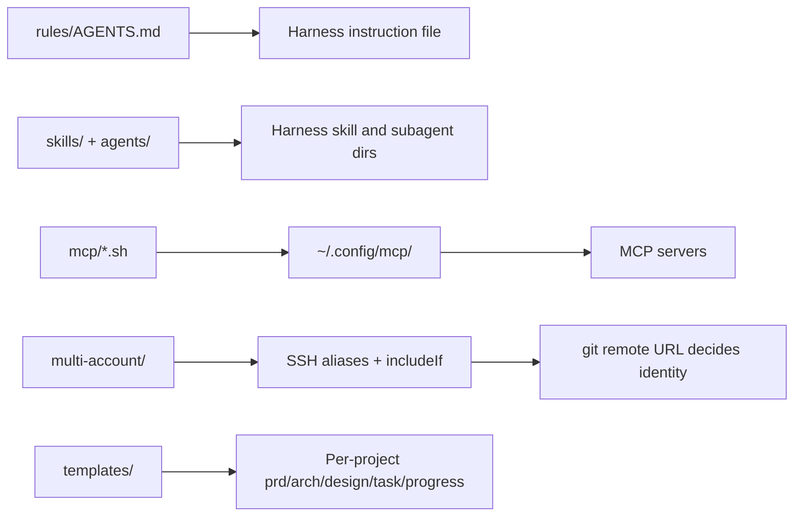

<div align="center">

# Agentic Workflow

**One agent setup that works with every agent.**

  

[](https://github.com/adineo-cmd/agentic-workflow/stargazers) [](https://github.com/adineo-cmd/agentic-workflow/commits)

[Quick start](#quick-start) · [How it works](#how-it-works) · [Features](#features)

</div>

---

A harness-agnostic agentic coding setup. Everything here works with **any**
agent or harness — opencode, ZCode, Claude Code, Gemini CLI, Windsurf, VS Code,
Cursor, Codex CLI — because nothing is locked to one tool.

Rules, subagents, skills, project templates, MCP wiring and a two-account git
identity, all in one place.

## Features

| | Feature | What it does |
| --- | --- | --- |
| 📜 | **Global rules** | `rules/AGENTS.md` — the behaviour contract every agent follows, portable to any harness. |
| 🤖 | **Agents and skills** | A code reviewer and a code simplifier, shipped both as subagent definitions and as `SKILL.md`s. |
| 🔌 | **MCP hub** | Token-free launcher scripts, reference server definitions and a per-harness wiring guide. |
| 👥 | **Two GitHub accounts** | SSH aliases plus `includeIf` identity switching — the remote URL decides the identity. |
| 🗂️ | **Project templates** | `prd`, `architecture`, `design`, `rules`, `task`, `progress` — one set per project. |
| 🧰 | **Session export** | A script that turns an opencode SQLite database into resumable session folders. |

## How it works

Nothing is installed by a package manager; everything is copied into the place
each harness reads from:

1. **Secrets** live in files under `~/.config/mcp/secrets/`, never in argv or
   config.
2. **Rules** are copied to the harness's instruction file.
3. **Skills and agents** are copied to the shared or harness-specific directory.
4. **Git identity** is handled by URL-based `includeIf` rules, so a clone from a
   work alias commits as work without any per-repo setup.



## Quick start

An agent harness that reads `AGENTS.md`, `SKILL.md` or one of its equivalents. Python 3 for the export tool; bash for the launchers.

**Wire up MCP**

```bash
cp mcp/github-personal.sh mcp/github-work.sh ~/.config/mcp/
chmod +x ~/.config/mcp/*.sh
mkdir -p ~/.config/mcp/secrets
printf '%s' "$TOKEN" > ~/.config/mcp/secrets/personal.token
chmod 600 ~/.config/mcp/secrets/personal.token
cat mcp/WIRING.md
```

**Copy rules and skills**

```bash
cp rules/AGENTS.md ~/.config/opencode/AGENTS.md
mkdir -p ~/.agents/skills
cp -r skills/* ~/.agents/skills/
```

**Two accounts**

```bash
cat multi-account/README.md
git clone git@github-personal:owner/repo.git
git clone git@github-work:owner/repo.git
```

## Project structure

```text
rules/            global agent rules
agents/           subagent definitions
skills/           the same tools in SKILL.md form
templates/        per-project documentation templates
mcp/              launcher scripts, server list, wiring guide
multi-account/    SSH aliases and git identity switching
tools/            session export
docs/             framework notes
```

## Principles

- **One config hub, many consumers.** Secrets and launchers live once; every
  harness points at them.
- **Copy, do not install.** Everything is plain files, so it works on any machine
  and any harness.
- **The URL decides identity.** Two GitHub accounts never need a per-repository
  `git config`.
- **Documentation is part of the work.** Every project keeps the six templates
  current.
